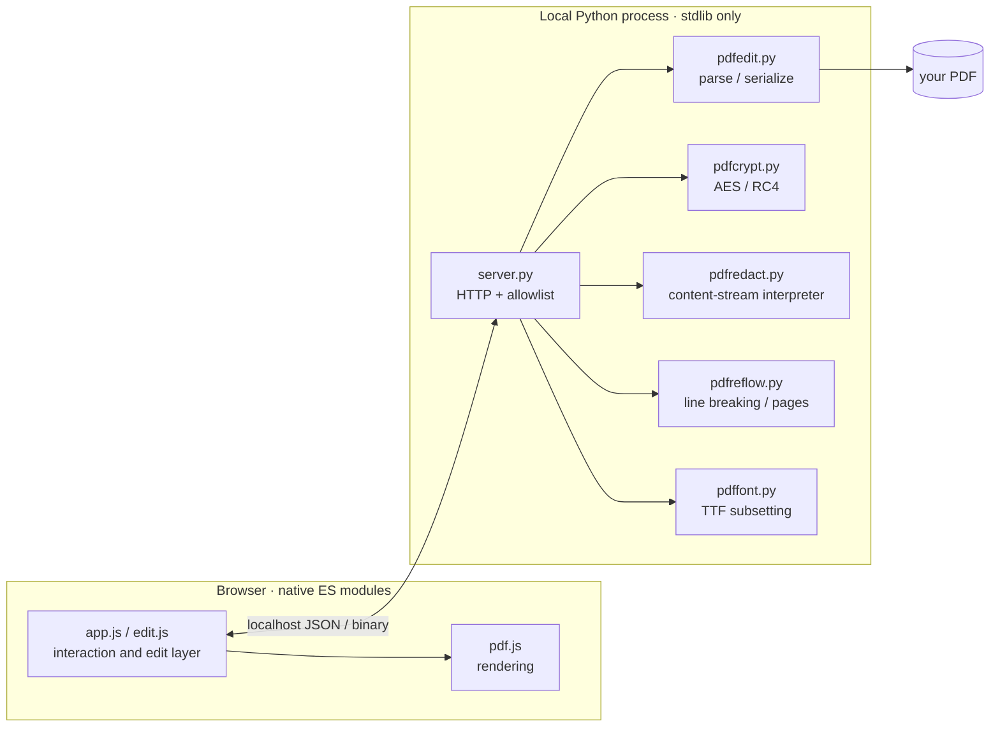

<div align="center">

<h1>PDF Editor</h1>

<p><b>Treat a PDF like source code.</b></p>

<p>
Redaction really deletes the glyphs from the content stream. Chinese text really embeds its outlines.<br>
Encryption really is AES-256 — not a black box painted over, not a page flattened to an image, not fake security.
</p>

[](#)
[](#)
[](#)
[](#-encryption-is-more-than-a-password)
[](#-why-trust-it)
[](LICENSE)

[](https://github.com/NEWSfuturestudio/PDF-editor/releases)

[简体中文](README.md) | English

</div>

---

> **Why this exists**
>
> I looked everywhere and could not find a PDF tool that actually *edits*.
> Most only read. Some shatter the font into mojibake the moment you type.
> And "redaction" is usually a black rectangle — run `strings` and the text is still right there.

---

## 🧩 Not another PDF reader

| How it's usually done | How it's done here |
|---|---|
| Redaction = paint a black rectangle | **Glyphs are deleted from the content stream.** `strings` won't find them, copy won't pick them up, re-saving won't carry them out |
| Whiteout = cover it up (text still inside) | Same operation, two ways to leave a trace — your call |
| Encryption = go install another tool | Set a password on export: **AES-256 / AES-128, both directions** |
| Edit = flatten the page and draw text on top | Double-click the body text and **edit in place** — it re-wraps, everything below moves down |
| Chinese = dump a system font in | **A hand-rolled TrueType subsetter**, embedding only the glyphs you use. Selectable, copyable |
| Ship an entire Electron stack | Backend is **12 MB**; not a single `pip install` |

---

## ⚡ Up and running in 30 seconds

```text
┌──────────────────────────────────────────────────────┐
│  $ python server.py --dir ~/Documents                │
│                                                      │
│  ✓  no pip install         ✓  no network             │
│  ✓  12 modules             ✓  0 third-party deps     │
│                                                      │
│  ➜  http://127.0.0.1:8000                            │
└──────────────────────────────────────────────────────┘
```

Four Windows packages, identical features (same backend) — the only difference is the shell:

| Package | Size | What it is |
|---|---|---|
| `electron-setup.exe` | 96 MB | **Standalone window · installer.** Bundles Chromium, so it doesn't matter whether Edge is installed |
| `electron.zip` | 125 MB | **Standalone window · portable.** Unzip and run. Writes nothing to the registry |
| `setup.exe` | 12 MB | **Browser tab · installer.** Smallest; opens in your default browser |
| `win64.zip` | 16 MB | **Browser tab · portable.** Unzip and run `PDFViewer.exe` |

Both flavours share one data directory (`%APPDATA%\PDFViewer`), so you can install
them side by side and switch freely — annotations and edits are all there.
The uninstaller asks before removing them.

No code-signing certificate, so the first launch is blocked by Windows once:
**More info → Run anyway**.

<details>
<summary><b>Run from source / build it yourself</b></summary>

<br>

```bash
python server.py --dir "path/to/your/pdfs"
# opens http://127.0.0.1:8000 (the port walks forward if taken)
```

Useful commands:

```bash
python run_tests.py        # full test suite (25 packages)
python check.py            # front-end static checks
python fontcheck.py x.ttf  # vet a font before swapping it in
pip install pyinstaller && python -m PyInstaller pdfviewer.spec   # build the exe
```

Building all four (run from the project root):

```powershell
# 1) Backend directory + browser portable
python -m PyInstaller pdfviewer.spec --noconfirm
Compress-Archive dist\PDFViewer\* dist\PDFViewer-win64.zip

# 2) Browser installer (uses the makensis bundled with electron-builder)
& "$env:LOCALAPPDATA\electron-builder\Cache\nsis\nsis-3.0.4.1\Bin\makensis.exe" `
  -DVERSION=<version> -DVERNUM=<x.x.x.0> packaging\installer.nsi

# 3) Both Electron packages
npx electron-builder --win
Compress-Archive release\win-unpacked\* release\PDFViewer-electron.zip
```

`pdfviewer.iss` (Inno Setup) is kept as an equivalent alternative if you have ISCC.

</details>

---

## 🛠️ Capability matrix

<details>
<summary><b>Expand the full list: read / annotate / edit / tables / redact / encrypt / export</b></summary>

<br>

| | |
|---|---|
| **Read** | Zoom, paging, single / two-page view, thumbnails, outline, search, bookmarks, invert colors |
| **Tabs** | Several documents in one window, each keeping its own scroll position, zoom, edit mode and undo stack (`Ctrl+Tab` to cycle, `Ctrl+W` to close) |
| **Annotate** | Highlight / underline / wavy / strikethrough / note / box → written as **native PDF comments**, still editable and deletable in Firefox or Acrobat after export |
| **Edit** | Shape objects (rectangle / ellipse / line / text / whiteout), insert images and signatures (PNG / JPEG, transparency preserved), page management, replace in place |
| **In-place text** | Double-click body text to edit. Font metrics measured live on canvas. Chinese **kinsoku** rules (`，。）】》」` hang past the margin, `（【《「` push to the next line) |
| **Reflow** | Rewrite a paragraph → it re-wraps → whatever no longer fits continues onto the next page, and the content below moves with it |
| **Tables** | Edit cell by cell (a longer value grows the row and the borders follow), rows detected by ruling lines, insert / delete a row (content moves, borders redrawn) |
| **Redact** | Frame an area, or give it a list of terms for the whole document: **delete and reflow** (following text closes the gap) or **redact in place** (layout unchanged). Zero matches is an error, never a silent no-op |
| **Encrypt** | Open encrypted PDFs (RC4 40/128, AES-128, AES-256 R5/R6); set a password and permissions on export |
| **Create** | Blank PDF from scratch (A4/A3/A5/Letter/Legal, landscape, 1–200 pages), opens straight into edit mode |
| **Export** | One click (edits and annotations included, never overwrites), page ranges, split into chunks, merge documents |

</details>

---

## 🔐 Encryption is more than a password

Both directions work: it opens other people's encrypted files, and produces its own.

| Variant | Read | Write | Notes |
|---|:--:|:--:|---|
| RC4 40 bit / V1·R2 | ✅ | ❌ | Existing files must open |
| RC4 128 bit / V2·R3 | ✅ | ❌ | Same |
| AES-128 / V4·R4 | ✅ | ✅ | Compatibility with older readers |
| AES-256 / V5·R5 | ✅ | ✅ | The Acrobat 9 hash |
| **AES-256 / V5·R6** | ✅ | ✅ | **PDF 2.0 — the default** |

**Why no RC4 on the write side:** shipping an RC4 file in 2026 is worse than
shipping nothing. It gives the illusion of encryption while the cipher is broken.

**About permission bits:** the no-print / no-copy / no-modify flags in `/P` are a
**reader-level agreement**. Acrobat and Foxit honour them; the PDFium inside
Chrome and Edge ignores them entirely. They stop casual use, not a determined
tool — the export dialog says exactly that, and it is not sold as DRM.

**Lose the password and the file is gone.** No recovery, no backdoor. `/O` and `/U`
hold hashes and derived keys, not a single byte that can reconstruct the plaintext.

**How it's verified:** every artefact goes through ① this repo's own decryptor,
② **pdf.js** (the engine inside the browser), and ③ a byte-for-byte comparison of
content streams against the unencrypted export. Encrypting and decrypting with your
own code lets both sides be wrong in the same way — an independent referee is mandatory.

---

## 🏗️ What it looks like



**The hard constraint: the source file is never modified — not one byte.**
Every edit is a new object layered on top, and export always writes a new file.
That is also what makes redaction genuinely unrecoverable.

---

## ⚠️ Known limits

An honest list, no varnish:

| | |
|---|---|
| Scanned documents | Not supported. Redaction can't touch text inside images — that needs OCR |
| Whole-document reflow | Not supported (tables can be edited cell by cell and rows deleted; reflowing everything needs a real layout engine) |
| Form fields | Neither filling nor creating (a signature can be pasted as a transparent PNG, but that is a picture, not a verifiable signature field) |
| Insert images | PNG / JPEG only. CMYK JPEG, 16-bit and interlaced PNGs are rejected with a hint to re-save |
| Edited paragraphs | Glyphs are substituted with a standard font, so they differ subtly from the surrounding text |
| Platforms | Packages are Windows-only; the source runs anywhere |

---

## 🧪 Why trust it

```
python run_tests.py   →  25 suites, 0 failures
python check.py       →  front-end static checks all pass
```

- **Zero third-party dependencies is literal**: all 33 `import`s resolve to the
  standard library or local modules — there is no `requirements.txt` at all
- **pdf.js is the referee for encryption** — not the code that wrote the file
- **Redaction has a leak test**: after deleting, it checks that `strings` can no
  longer find the original text
- **check.py is a hard gate**: DOM ids, import/export matching, `hidden` fallbacks,
  variables shadowing the translation function — checked by category, not by eye

---

## 📁 Layout

```
server.py      HTTP routes + API + path allowlist
launcher.py    exe entry point (start server, open window)
appenv.py      path rules for source vs. frozen builds
pdfedit.py     PDF read/write engine (parse / serialize / append content streams)
pdfcrypt.py    standard security handler (RC4 / AES-128 / AES-256, read and write)
pdfredact.py   redaction engine (content-stream interpreter, glyph removal, leak cleanup)
pdfreflow.py   paragraph reflow (line breaking, page-local shifting, cross-page continuation)
pdfbatch.py    batch: find & replace / delete-or-redact by term / range export / split / merge
pdfannot.py    annotations → native PDF comments
pdffont.py     TrueType subsetting
pdfimage.py    image embedding
pdfnew.py      blank PDF generation
static/        front end (native ES modules, no framework, no build step)
```

Architecture notes, data model and testing philosophy: **[docs/ARCHITECTURE.md](docs/ARCHITECTURE.md)**.

---

## 🔤 Fonts

`assets/fonts/NotoSansSC-Regular.ttf` (Source Han Sans, OFL, glyf outlines).

A replacement must be OFL-embeddable, use glyf outlines, and have a regular weight
as its default instance. Override the path with `PDFVIEWER_CJK_FONT`;
`fontcheck.py` will tell you whether a candidate qualifies.

---

<div align="center">

<br>

**Filling in the missing pieces of open source, one `0x3f3f3f3f` at a time.**

<sub>Built by <a href="https://github.com/NEWSfuturestudio">NEWSfuturEStudio</a> · GPL-3.0 · <code>while(true) { code(); }</code></sub>

</div>
