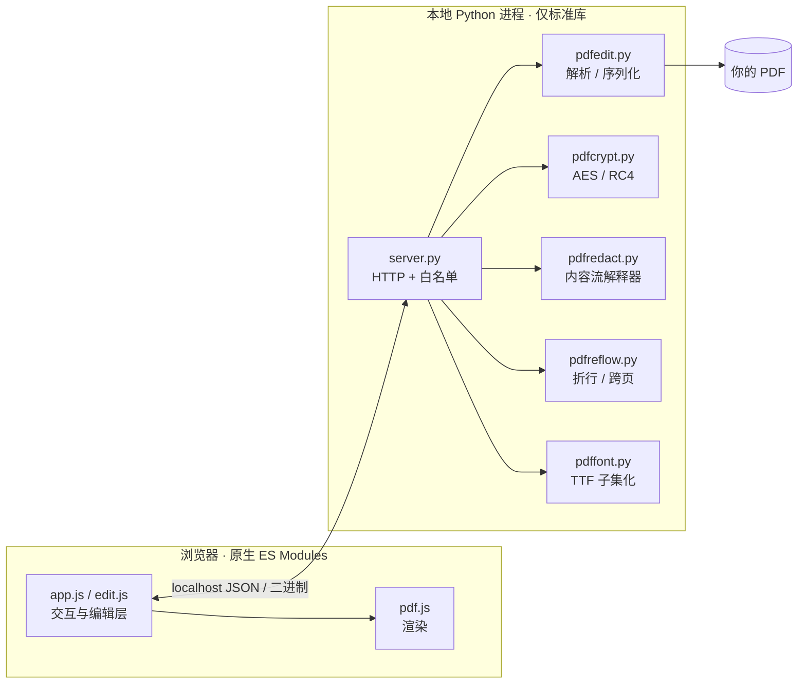

<div align="center">

<h1>PDF Editor</h1>

<p><b>把 PDF 当成源码来改。</b></p>

<p>
涂黑是真的把字从内容流里删掉，中文是真的把字形嵌进去，<br>
加密是真的 AES-256 —— 不是盖一块黑的，不是转成图片，不是假安全。
</p>

[](#)
[](#)
[](#)
[](#-加密不只是加个口令)
[](#-它凭什么值得信任)
[](LICENSE)

[](https://github.com/1ZJYQWQ/PDF-editor/releases)

简体中文 | [English](README.en.md)

</div>

---

> **为什么会有这个东西**
>
> 找遍了也没找到一个"能真改"的 PDF 工具：
> 要么只能看；要么改完字体崩成一团乱码；
> 要么涂黑只是盖个黑块 —— 用 `strings` 一搜，原文全在。

---

## 🧩 它不是"又一个 PDF 阅读器"

| 别人怎么做 | 这里怎么做 |
|---|---|
| 涂黑 = 盖一个黑色矩形 | **从内容流里删掉字形**。`strings` 搜不到，复制不到，转存也带不出来 |
| 涂白 = 遮住（但文字还在） | 同一件事，两种留痕方式，你选 |
| 加密 = 去装个别的工具 | 导出时设口令，**AES-256 / AES-128 双向支持** |
| 编辑 = 页面转成图片再画字 | 双击正文**原地改**，改完重新折行，下方内容跟着走 |
| 中文 = 塞个系统字体 | **自写 TTF 子集化引擎**，只嵌用到的字形，能选中能复制 |
| 装个 Electron 全家桶 | 后端 **12 MB**，`pip install` 一个包都不用 |

---

## ⚡ 三十秒上手

```text
┌──────────────────────────────────────────────────────┐
│  $ python server.py --dir ~/Documents                │
│                                                      │
│  ✓  no pip install         ✓  no network             │
│  ✓  12 modules             ✓  0 third-party deps     │
│                                                      │
│  ➜  http://127.0.0.1:8000                            │
└──────────────────────────────────────────────────────┘
```

四个 Windows 包，功能完全一样（同一份后端），区别只在"外壳"：

| 包 | 体积 | 是什么 |
|---|---|---|
| `electron-setup.exe` | 96 MB | **独立窗口 · 安装**。自带 Chromium，系统装没装 Edge 都无所谓 |
| `electron.zip` | 125 MB | **独立窗口 · 免安装**。解压即用，不写注册表 |
| `setup.exe` | 12 MB | **浏览器标签页 · 安装**。体积最小，用你默认的浏览器 |
| `win64.zip` | 16 MB | **浏览器标签页 · 免安装**。解压后双击 `PDFViewer.exe` |

两个版本共用同一份数据目录（`%APPDATA%\PDFViewer`），可以都装、换着用，
标注和编辑记录都在。卸载时会问一句要不要一并删掉，不点「是」就留着。

没买代码签名证书，第一次运行 Windows 会拦一下：**更多信息 → 仍要运行**。

<details>
<summary><b>从源码跑 / 自己打包</b></summary>

<br>

```bash
python server.py --dir "你的 PDF 目录"
# 默认浏览器打开 http://127.0.0.1:8000（端口被占会自动顺延）
```

常用命令：

```bash
python run_tests.py        # 全部测试（25 个套件）
python check.py            # 前端静态自检
python fontcheck.py x.ttf  # 换字体前体检
pip install pyinstaller && python -m PyInstaller pdfviewer.spec   # 自己打 exe
```

四个包怎么打（在项目根目录）：

```powershell
# 1) 后端目录版 + 浏览器免安装
python -m PyInstaller pdfviewer.spec --noconfirm
Compress-Archive dist\PDFViewer\* dist\PDFViewer-win64.zip

# 2) 浏览器版安装包（用 electron-builder 缓存里的 makensis，不必另装 NSIS）
& "$env:LOCALAPPDATA\electron-builder\Cache\nsis\nsis-3.0.4.1\Bin\makensis.exe" `
  -DVERSION=<版本> -DVERNUM=<x.x.x.0> packaging\installer.nsi

# 3) Electron 两种包
npx electron-builder --win
Compress-Archive release\win-unpacked\* release\PDFViewer-electron.zip
```

`pdfviewer.iss`（Inno Setup）也留着，装了 ISCC 的话编出来等价。

</details>

---

## 🛠️ 能力矩阵

<details>
<summary><b>展开完整清单：阅读 / 标注 / 编辑 / 表格 / 涂黑 / 加密 / 导出</b></summary>

<br>

| | |
|---|---|
| **阅读** | 缩放、翻页、单页 / 双栏、缩略图、目录、搜索、书签、反色 |
| **多标签** | 一个窗口开多份，各自记住滚动位置、缩放、编辑态与撤销栈（`Ctrl+Tab` 轮换、`Ctrl+W` 关闭） |
| **标注** | 高亮 / 下划线 / 波浪线 / 删除线 / 便签 / 方框 → 写成 **PDF 原生注释**，导出后在 Firefox、Acrobat 里还能改能删 |
| **编辑** | 图形对象（矩形 / 椭圆 / 直线 / 文字 / 涂白）、插入图片与签名（PNG / JPEG，保留透明）、页面管理、原位替换 |
| **原地改字** | 双击正文直接编辑，字体度量按 canvas 实测对齐，中文**避头尾**（`，。）】》」` 悬挂、`（【《「` 推行） |
| **段落重排** | 改写一段 → 重新折行 → 放不下就续到下一页，下方内容跟着移动 |
| **表格** | 一格一格改字（改长自动撑高整行，边框跟着走）、按表格线认行、插行 / 删行（下面内容跟着走） |
| **涂黑** | 框选，或给一串关键词全篇处理：**删掉并重排**（后面的字补位）或**涂黑留痕**（版面不动）。零命中直接报错，不静默跳过 |
| **加密** | 打开加密 PDF（RC4 40/128、AES-128、AES-256 R5/R6）；导出时设口令与权限 |
| **新建** | 从零生成空白 PDF（A4/A3/A5/Letter/Legal，可横向，1~200 页），建好直接进编辑模式 |
| **导出** | 一键导出（编辑与批注一并写入，撞名不覆盖）、按页码范围、按份拆分、多份合并 |

</details>

---

## 🔐 加密不只是加个口令

这个工具**两个方向都能走**：能读别人的加密文件，也能产出自己的。

| 档位 | 读 | 写 | 说明 |
|---|:--:|:--:|---|
| RC4 40 bit / V1·R2 | ✅ | ❌ | 存量文件必须能开 |
| RC4 128 bit / V2·R3 | ✅ | ❌ | 同上 |
| AES-128 / V4·R4 | ✅ | ✅ | 老阅读器兼容 |
| AES-256 / V5·R5 | ✅ | ✅ | Acrobat 9 时代的哈希 |
| **AES-256 / V5·R6** | ✅ | ✅ | **PDF 2.0，默认档位** |

**为什么写侧不产 RC4：** 2026 年再发一个 RC4 文件，比不加密更危险 ——
它给人"我加密了"的错觉，而算法本身已经可破。

**权限位说清楚：** `/P` 里的禁打印 / 禁复制 / 禁修改是**阅读器层面的约定**，
Acrobat、福昕会遵守，Chrome / Edge 内置的 PDFium 根本不看。
它能挡住随手操作，挡不住专门工具 —— 弹窗里也是这么写的，不拿它当 DRM 卖。

**口令丢了就真没了。** 没有找回途径、没有后门，`/O` `/U` 里只有哈希和密钥，
没有一句话能还原原文。

**验证方式：** 产物同时交给 ① 本仓库解密器 ② **pdf.js**（浏览器同引擎）
③ 逐字节比对明文版的内容流。自己加密自己解密会两边一起错互相抵消，
所以必须有第三方裁判。

---

## 🏗️ 它长什么样



**核心约束：原文件一个字节都不改。** 所有编辑都是"往上盖"的新对象，
导出永远是生成新文件 —— 这也是涂黑能真正做到不可恢复的前提。

---

## ⚠️ 已知边界

诚实清单，不粉饰：

| | |
|---|---|
| 扫描件 | 不支持。涂黑对图片里的文字无效，那需要 OCR |
| 整篇重排 | 不支持（表格能一格一格改、能删行；整篇重排要真正的排版引擎） |
| 表单域 | 不支持填写与生成（签名可以贴一张透明 PNG，但那是一张图，不是可验签的签名域） |
| 插入图片 | 只收 PNG / JPEG。CMYK 的 JPEG、16 位或隔行扫描的 PNG 会被拒绝并提示转存 |
| 改过的段落 | 字体替换成标准字体，字形与原上下文有细微差异 |
| 系统 | 打包只出 Windows；源码可在任意平台跑 |

---

## 🧪 它凭什么值得信任

```
python run_tests.py   →  25 个套件，0 失败
python check.py       →  前端静态自检全过
```

- **零第三方依赖是真的**：33 个 `import` 全部来自标准库或本地模块，
  连 `requirements.txt` 都不存在
- **加密用 pdf.js 当裁判**：不是自己验自己
- **涂黑有泄漏面测试**：删完还要检查 `strings` 搜不到原文
- **check.py 是硬门槛**：DOM id、import/export 匹配、hidden 兜底、
  变量遮蔽翻译函数 —— 一类一类查，不靠人眼

---

## 📁 目录

```
server.py      HTTP 路由 + API + 路径白名单
launcher.py    exe 入口（起服务 + 开窗口）
appenv.py      源码跑 / exe 跑 的路径规则
pdfedit.py     PDF 读写引擎（解析 / 序列化 / 内容流追加）
pdfcrypt.py    标准安全处理器（RC4 / AES-128 / AES-256，读写双向）
pdfredact.py   涂黑引擎（内容流解释器 + 整字删除 + 泄漏面清理）
pdfreflow.py   段落重排（折行 + 页内下移 + 跨页续排）
pdfbatch.py    批量：查找替换 / 按词删除或涂黑 / 范围导出 / 拆分 / 合并
pdfannot.py    批注 → PDF 原生注释
pdffont.py     TrueType 子集化
pdfimage.py    图片嵌入
pdfnew.py      空白 PDF 生成
static/        前端（原生 ES Module，无框架无构建）
```

架构细节、核心模型与测试理念见 **[docs/ARCHITECTURE.md](docs/ARCHITECTURE.md)**。

---

## 🔤 字体

`assets/fonts/NotoSansSC-Regular.ttf`（思源黑体，OFL 授权，glyf 轮廓）。

换字体必须满足：OFL 可嵌入、glyf 轮廓、默认实例是常规字重。
可用环境变量 `PDFVIEWER_CJK_FONT` 覆盖路径，`fontcheck.py` 会告诉你合不合格。

---

<div align="center">

<br>

**用 `0x3f3f3f3f` 的时间，填补开源的每一块拼图。**

<sub>Built by <a href="https://github.com/NEWSfuturestudio">NEWSfuturEStudio</a> · Apache-2.0 · <code>while(true) { code(); }</code></sub>

</div>
